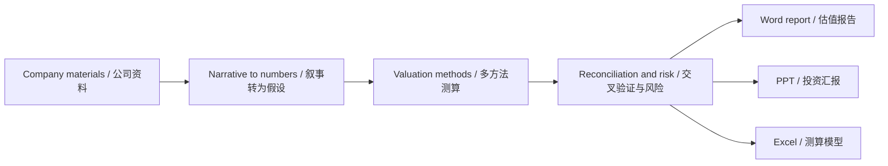
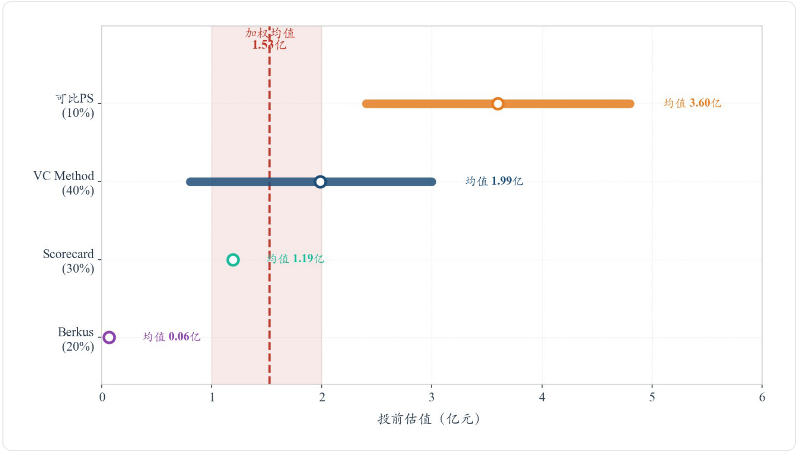
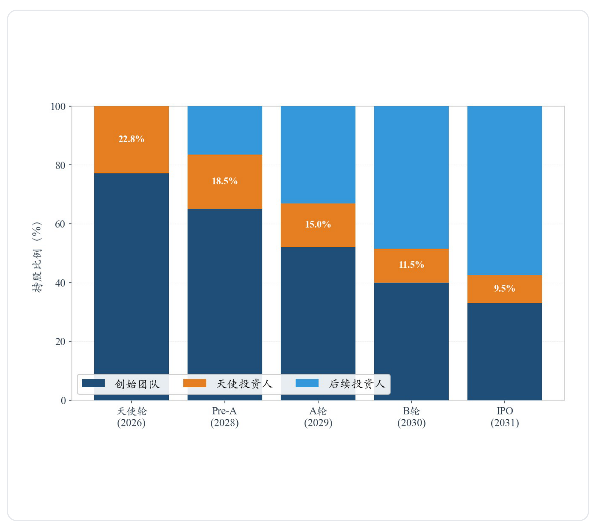
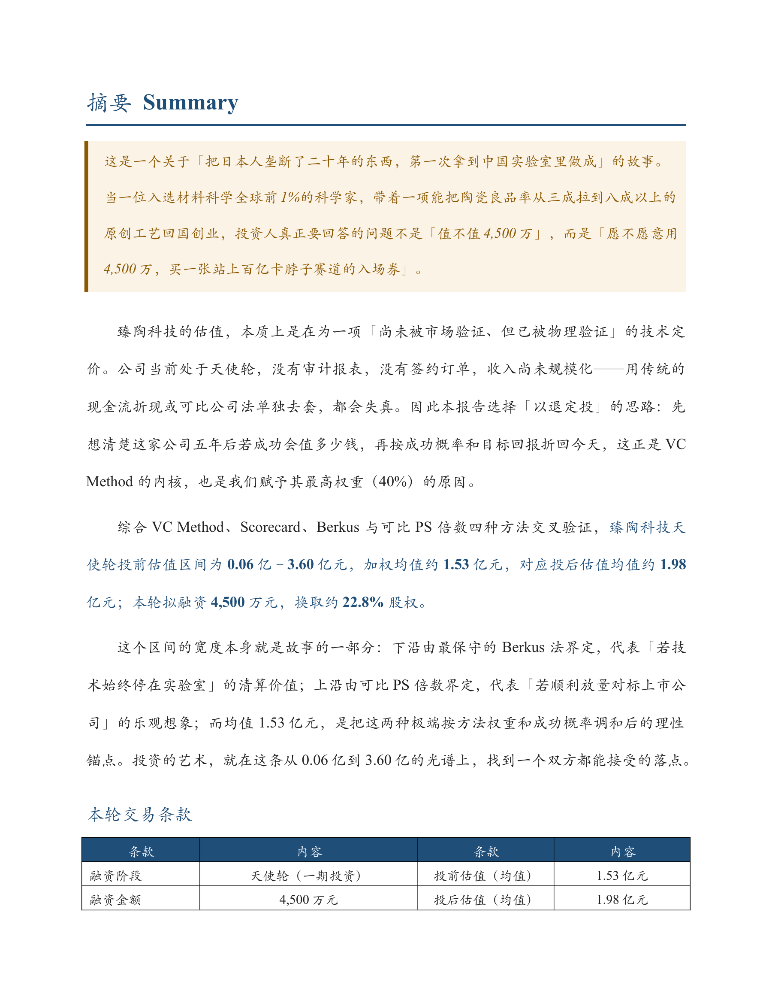
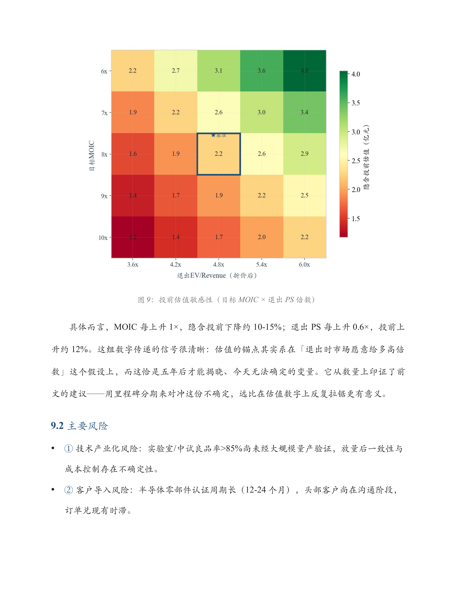
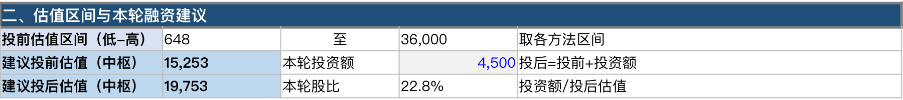
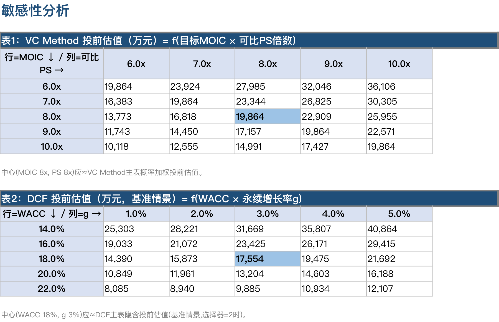

# Primary Valuation / 一级市场估值

**English**  
Primary Valuation is a specialized valuation workflow designed for the primary market, comprehensively covering scenarios such as startups, private financing, VC/growth equity investments, and Pre-IPO stages. It transforms complex valuations into an analytical framework that integrates "quantitative digital models" with "qualitative narrative storytelling." Supporting mainstream methodologies such as Discounted Cash Flow (DCF), Comparable Transaction Analysis, Venture Capital Valuation, Scorecard analysis, and Cap Table / Waterfall modeling, it automatically generates standardized deliverables, including Word valuation reports, PPT presentations, and Excel templates.

**中文**  
Primary Valuation 是专为一级市场打造的专业估值工作流，全面覆盖初创企业、私募融资、VC/成长型股权投资及 Pre-IPO 等核心场景。该工作流将复杂的估值过程转化为“量化数字模型”与“定性文字故事”深度结合的分析体系。Primary Valuation 内置了现金流折现（DCF）、可比交易分析、风险投资估值、Scorecard 分析以及 Cap Table / Waterfall 建模等多种主流方法，并能自动生成 Word 估值报告、PPT 演示文稿及 Excel 数据模板等标准化交付物。

---

## Workflow / 工作流程



Start with the company's materials, translate the business narrative into model assumptions, and reconcile the valuation methods before reviewing the report, presentation, and model together.

先整理企业资料，将商业叙事转化为模型假设，再对各方法结果进行交叉验证，最后结合报告、演示文稿和模型查看结论。

## Repository Structure / 仓库结构

```text
primary-valuation/
├── README.md              Project overview / 项目说明与示例预览
├── Example/               Editable samples / 可编辑示例
│   ├── TZTech_example.docx
│   ├── TZTech_example.pptx
│   └── TZTech_example.xlsx
├── SKILL.md               Skill definition / Skill 定义
├── requirements.txt       Python dependencies / Python 依赖
├── agents/                Agent configuration / Agent 配置
├── assets/                JSON schema and sample inputs / 输入结构与示例配置
├── docs/
│   ├── USAGE.md           Script usage guide / 脚本使用指南
│   └── images/            README screenshots / README 示例截图
├── references/            Methodology and report guidance / 方法论与报告指南
├── skills/                DCF, comps, and competitive analysis / 专项子技能
└── scripts/               Valuation and report scripts / 估值与报告脚本
```

See [the usage guide / 脚本使用指南](docs/USAGE.md) for the script workflow.

---

## Valuation Logic / 估值逻辑

**English**  
For startups, the answer is rarely a single valuation figure. Early-stage companies typically have limited historical data, unvalidated product-market fit, high future dilution risks, and value realization that is highly dependent on exit pathways. Therefore, Primary Valuation's valuation philosophy draws upon Aswath Damodaran's "Narrative to Numbers" framework, while also incorporating methodologies specific to the primary market:

| Valuation Lens | Financial Meaning |
|---|---|
| VC Method | What valuation allows the investor to reach the required MOIC or IRR? |
| Scorecard | How does the company compare with other early-stage companies on team, market, product, traction, and risk? |
| Comparable Financing | How is the private market pricing similar companies or similar rounds? |
| DCF / Narrative Value | What intrinsic value is implied by the business story, growth, margin, reinvestment, and risk? |
| PWERM / Scenario Analysis | How do IPO, M&A, continued operation, or failure scenarios affect value? |
| Cap Table / Waterfall | How much of the exit value actually flows to each shareholder class? |

**中文**  
对于创业公司，答案通常不是一个单一的估值数字。早期公司历史数据有限，产品市场匹配尚未完全验证，未来稀释风险高，价值实现也高度依赖退出路径。因此，Primary Valuation 的估值思想借鉴了 Aswath Damodaran 的“叙事到数字”框架，同时结合一级市场特有方法。

Primary Valuation 不依赖单一估值方法，而是对多个估值视角进行交叉验证：

| 估值视角 | 金融含义 |
|---|---|
| VC Method | 在目标 MOIC 或 IRR 下，投资人能够接受的估值是多少？ |
| Scorecard | 公司在团队、市场、产品、牵引力和风险方面相对同阶段公司如何？ |
| 可比融资 | 私募市场如何给类似公司或类似轮次定价？ |
| DCF / 叙事价值 | 商业故事、增长、利润率、再投资和风险隐含的内在价值是多少？ |
| PWERM / 情景分析 | IPO、并购、继续经营或失败等路径如何影响价值？ |
| Cap Table / 瀑布分配 | 退出价值最终如何分配到不同股东和证券类别？ |

---

## Example Preview / 示例预览

Preview the sample deliverables below, or download the editable Word, PowerPoint, and Excel files from [`Example/`](Example/).

下方提供示例截图与阅读说明，也可前往 [`Example/`](Example/) 下载可编辑的 Word 报告、PPT 和 Excel 模型。

The files in `Example/` use 臻陶科技 (TZTech), a fictional semiconductor ceramics company, to illustrate an angel-round valuation package. Screenshots below are rendered from those files, with selected slide regions cropped for readability. Figures and assumptions are illustrative; the examples are primarily in Chinese.

`Example/` 以虚构的半导体陶瓷企业“臻陶科技”为案例，展示一套天使轮估值交付物。下方截图均由目录中的实际文件渲染，部分幻灯片截取了重点区域以便阅读，案例数字与假设仅用于演示，示例内容以中文为主。



**At a glance:** this chart compares the pre-money values from four methods. The dashed line marks the weighted result, making the dispersion between methods visible.

**先看结论：**这张图对比四种方法的投前估值范围，并用虚线标出加权结果，直观展示不同方法的结果差异。完整 PPT 同时提供本轮融资额、投后估值与股比摘要。

| Deliverable / 交付物 | What to explore / 阅读重点 | File / 示例文件 |
|---|---|---|
| Word report / 估值报告 | Business narrative, methodology, assumptions, and risks / 商业叙事、方法选择、假设与风险 | [TZTech_example.docx](Example/TZTech_example.docx) |
| PowerPoint / 投资汇报 | Valuation summary, method comparison, and dilution / 估值结论、方法比较与股权稀释 | [TZTech_example.pptx](Example/TZTech_example.pptx) |
| Excel model / 测算模型 | Valuation calculations, sensitivities, financing, and sources / 估值测算、敏感性、融资与来源 | [TZTech_example.xlsx](Example/TZTech_example.xlsx) |

### PowerPoint / 从估值方法到投资人回报

**How the methods fit together:** this example assigns weights to VC Method, Scorecard, Berkus, and comparable PS. DCF provides a separate intrinsic-value check and is excluded from the weighted result. These weights belong to this case and should be reconsidered for each company.

**理解方法分工：**示例对 VC Method、Scorecard、Berkus 和可比 PS 分配权重，DCF 作为独立的内在价值校验，不纳入加权结果。这里的权重属于本案例，实际项目需结合企业阶段和资料质量重新判断。



**Follow the ownership:** the chart shows how later rounds affect the angel investor's stake; the full slide also includes financing assumptions. Read the exit return alongside the assumed financing path and exit value.

**追踪股权变化：**图表展示后续轮次如何稀释天使投资人的持股，完整幻灯片另附融资假设表。阅读退出回报时，应同时查看后续融资假设和退出价值，理解估值如何影响投资人的实际收益。

### Word / 阅读完整分析与风险解释

<table>
  <tr>
    <td width="50%"><a href="docs/images/example-word-summary.png"></a></td>
    <td width="50%"><a href="docs/images/example-word-sensitivity.png"></a></td>
  </tr>
</table>

**Read the reasoning:** the summary connects transaction terms to the valuation conclusion, while the sensitivity and risk section explains which assumptions move the result. Click either image to enlarge it, or download the report for the full narrative.

**阅读推导过程：**摘要页将交易条款与估值结论对应起来，敏感性与风险章节解释哪些假设会显著影响结果。点击图片可放大查看，完整叙事、方法说明和风险分析见 Word 文件。

### Excel / 核对估值与敏感性



**Trace the conclusion:** this excerpt shows the valuation range and financing terms. The full summary sheet also includes method values and weights. The workbook also includes VC Method, Scorecard, Berkus, comparable valuation, DCF, sensitivity analysis, financing and ownership, and assumptions and sources.

**核对结论来源：**截图展示“摘要与结论”中的估值区间与融资条款，完整工作表另附各方法估值与权重。工作簿还包含 VC Method、Scorecard、Berkus、可比估值、DCF、敏感性分析、融资与股权、假设与来源等工作表，便于沿着模型查看具体测算。



**Test the assumptions:** the two grids compare target MOIC against exit PS, and WACC against perpetual growth. They help show how much a valuation depends on the selected return target, exit multiple, and discounting assumptions.

**观察假设变化：**两张矩阵分别展示“目标 MOIC × 退出 PS”和“WACC × 永续增长率”对估值的影响，用来判断结论对回报要求、退出倍数和折现假设的敏感程度。

> These screenshots preview the existing samples. They do not imply identical layout or figures for every generated output. Sample files may use different reporting dates or detailed assumptions; check each file before reusing its numbers.<br>
> 截图用于展示现有示例，不代表每次生成的版式与数字完全相同。不同示例文件中的基准日期或细项假设可能不同，引用数字前请核对各文件的具体口径。

---

## Install Locally / 本地安装

**English**  
Method 1 (Recommended): Ask an AI agent to install.  
Copy the repository URL and ask an AI agent to download and install the skill for you.

```text
Please help me download and install the Codex skill from this repository:
https://github.com/Flying-Potato123/primary-valuation
```

Method 2: Manual copy or symlink.  
Clone or download this repository, then place the skill directory into your Codex skills folder.

```bash
git clone https://github.com/Flying-Potato123/primary-valuation.git
mkdir -p ~/.codex/skills
ln -s /path/to/primary-valuation ~/.codex/skills/primary-market-valuation
```

If you prefer copying instead of symlinking:

```bash
mkdir -p ~/.codex/skills
cp -R /path/to/primary-valuation ~/.codex/skills/primary-market-valuation
```

Restart Codex or open a new session after installation.

**中文**  
方法 1（推荐）：让 AI agent 帮你安装。  
复制这个仓库链接，让 AI agent 帮你下载并安装 skill。

```text
请帮我下载并安装这个仓库里的 Codex skill：
https://github.com/Flying-Potato123/primary-valuation
```

方法 2：手动复制或软链接。  
克隆或下载本仓库，然后把 skill 目录放入 Codex skills 文件夹。

```bash
git clone https://github.com/Flying-Potato123/primary-valuation.git
mkdir -p ~/.codex/skills
ln -s /path/to/primary-valuation ~/.codex/skills/primary-market-valuation
```

如果您更希望复制文件而不是创建软链接：

```bash
mkdir -p ~/.codex/skills
cp -R /path/to/primary-valuation ~/.codex/skills/primary-market-valuation
```

安装后，重启 Codex 或开启新的 Codex 会话即可。

---

## Usage / 使用方法

**English**  
After installation, you can invoke the skill by explicitly asking Codex to use `primary-market-valuation`. A good prompt should briefly state the company, financing stage, available materials, and desired outputs.

General prompt:

```text
Use the primary-market-valuation skill to value this company.

Company: [company name and short description]
Stage: [Angel / Seed / Pre-A / A / Growth / Pre-IPO]
Available materials: [BP, pitch deck, financial forecast, cap table, term sheet]
Deliverables: [valuation range, Word report, PPT, Excel model, cap table analysis]
Please use a narrative-to-numbers framework and clearly label assumptions and sources.
```

Common task prompts:

```text
Use the primary-market-valuation skill to generate a full valuation report, PPT, and Excel model for this Angel round financing.
```

```text
Use the primary-market-valuation skill to provide only a quick pre-money valuation range and the key assumptions behind it.
```

```text
Use the primary-market-valuation skill to analyze the cap table, ESOP expansion, dilution path, and waterfall distribution for this financing round.
```

```text
Use the primary-market-valuation skill to review this investment memo and identify valuation assumptions, missing sources, method mismatches, and key risks.
```

**中文**  
安装后，您可以在提示词中明确要求 Codex 使用 `primary-market-valuation`。一个好的提示词应简要说明公司、融资阶段、已有资料和希望生成的交付物。

通用提示词：

```text
请使用 primary-market-valuation skill 对这家公司进行估值。

公司：[公司名称和简要介绍]
阶段：[天使轮 / 种子轮 / Pre-A / A轮 / 成长期 / Pre-IPO]
已有资料：[BP、Pitch Deck、财务预测、Cap Table、Term Sheet]
需要交付：[估值区间、Word 报告、PPT、Excel 模型]
请使用“叙事到数字”的框架，并清楚标注关键假设和数据来源。
```

常见任务提示词：

```text
请使用 primary-market-valuation skill，为这个天使轮融资项目生成完整估值报告、PPT 和 Excel 模型。
```

```text
请使用 primary-market-valuation skill，请你对项目进行DCF估值，并说明关键假设。
```

```text
请使用 primary-market-valuation skill，分析本轮融资的 Cap Table、期权池扩容、稀释路径和瀑布分配。
```

```text
请使用 primary-market-valuation skill，复核这份投资报告，识别估值假设、缺失来源、方法不匹配和关键风险。
```

---

## Data and Source Discipline / 数据与来源规范

**English**  
Primary Valuation does not automatically guarantee that input data is accurate, complete, or current. Public market data, financing transactions, industry benchmarks, Damodaran data, and company-provided forecasts should be independently verified before being used in formal investment materials.

Every important assumption should be labeled as one of the following:

- Observed / observed data
- Company-provided / company-provided data
- Public source / public market or industry source
- Private transaction / private financing or transaction data
- Analyst judgment / analyst judgment
- Sensitivity / sensitivity assumption

**中文**  
Primary Valuation 不会自动保证输入数据真实、完整或最新。公开市场数据、融资交易、行业基准、Damodaran 数据和公司提供的预测，在用于正式投资材料前都应独立核验。

每一个重要假设都应标注为以下类型之一：

- Observed / 已观察数据
- Company-provided / 公司提供
- Public source / 公开来源
- Private transaction / 私募交易
- Analyst judgment / 分析师判断
- Sensitivity / 敏感性假设

---

## Disclaimer / 免责声明

**English**  
This project is for research, education, and internal analytical use only. It does not constitute investment advice, valuation opinion, financing advice, legal advice, accounting advice, or any regulated financial recommendation.

**中文**  
本项目仅用于研究、教学和内部分析，不构成投资建议、估值意见书、融资建议、法律建议、会计建议或任何受监管金融建议。

---

## License / 许可证

**English**  
This project uses the MIT open-source license. Please refer to the repository license file for details.

**中文**  
本项目采用 MIT 开源许可证。具体授权条款请以仓库中的 License 文件为准。
